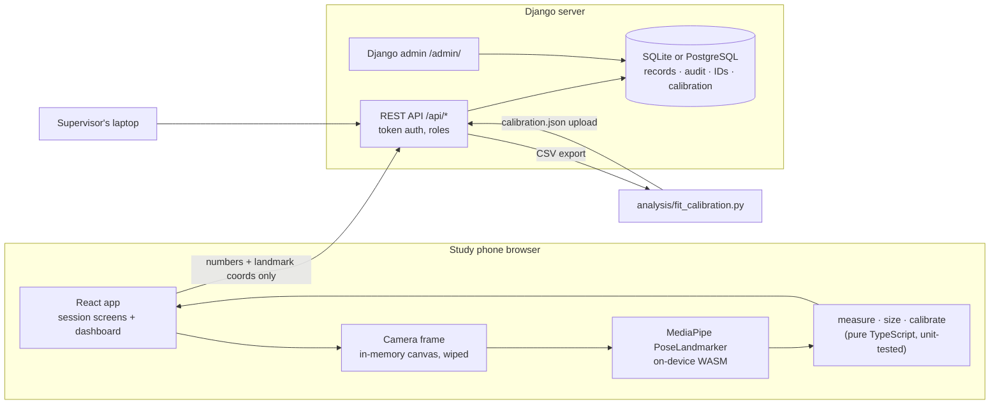

# FitScan

A research app that compares phone-photo body measurements with tape measurements and recommends a
clothing size from each. One researcher runs in-person sessions on a phone; anyone with a study
account can see the collected data on a dashboard.

- **frontend/**: React 18 + Vite + TypeScript + Tailwind. MediaPipe PoseLandmarker runs in the browser.
- **backend/**: Django 5 + Django REST Framework. Accounts, the database, the API, the audit log and the Django admin site.
- **analysis/**: the offline calibration script.

Participants are anonymous (P001, P002, …). Photos are analysed on the phone and never sent to the
server. Only derived numbers and landmark coordinates are stored.

---

## Who can do what

| Account type | Run sessions | See dashboard and records | Correct records | Download CSV | Upload calibration | Admin site |
|---|---|---|---|---|---|---|
| **Researcher** (group) | ✓ | ✓ | ✓ (reason required) | ✓ | ✓ | – |
| **Viewer** (group), e.g. a supervisor | – | ✓ | – | ✓ | – | – |
| **Superuser** | ✓ | ✓ | ✓ | ✓ | ✓ | ✓ |

Every user can change their own password under **Account**. Changing it signs that account out on other devices.
Forgotten passwords are reset by a superuser in the admin site (`/admin/` → Users → the user → "Reset password").

---

## 1. Run it on your laptop

You need **Python 3.11+** and **Node.js 18+**.

```bash
# Backend (terminal 1)
cd backend
python -m venv .venv
source .venv/bin/activate          # Windows: .venv\Scripts\activate
pip install -r requirements.txt
python manage.py migrate
python manage.py create_user anita --role researcher --superuser   # prompts for a password (10+ chars)
python manage.py runserver

# Frontend (terminal 2)
cd frontend
npm install
npm run dev                        # open http://localhost:5173
```

During development Vite forwards `/api` to Django on port 8000.

**Want to see the dashboard with data before real sessions?**
`python manage.py seed_demo --n 20` adds synthetic participants marked `demo`.
Remove them with `python manage.py seed_demo --clear`. Never use this on the live study database.

**Add more accounts**
```bash
python manage.py create_user supervisor --role viewer
```
You can also add users in the admin site and put them in the *Researcher* or *Viewer* group.

### Tests
```bash
cd backend && python manage.py test study     # 14 API tests
cd frontend && npm test                        # 56 unit tests (measurement, sizes, calibration, tape, SUS)
```

---

## 2. Put it online (needed for the phone camera)

Phone browsers only allow the camera over **HTTPS**, so deploy before testing on the phone.
In production Django serves the built React app itself, so it is **one web service**.

Any Python host works (Render, Railway, PythonAnywhere, a VPS). The general recipe:

1. Copy `backend/.env.example` to `backend/.env` (or set the same variables in the host's dashboard):
   `DJANGO_DEBUG=false`, a long random `DJANGO_SECRET_KEY`, your domain in `DJANGO_ALLOWED_HOSTS` and
   `DJANGO_CSRF_TRUSTED_ORIGINS`.
2. **Build command:** `bash backend/build.sh` (builds the React app, collects static files, migrates).
3. **Start command:** `cd backend && gunicorn config.wsgi --bind 0.0.0.0:$PORT`
4. **Database:** many free hosts wipe local files on redeploy, so use PostgreSQL there and set
   `DATABASE_URL=postgres://…`. SQLite is fine on a VPS or PythonAnywhere.
5. Open a shell on the host and run `python manage.py create_user …` once.

Check that your ethics approval allows where the server and database are hosted.

### Optional: self-host the pose model
By default the model downloads from Google's storage on the first scan. For weak connections:
```bash
cd frontend && npm run fetch-model
echo "VITE_MP_MODEL_URL=/models/pose_landmarker_heavy.task" >> .env.local
```

---

## 3. Session flow (phone)

| Step | Screen | What happens |
|---|---|---|
| 1 | Session | Next ID reserved on the server (P001, P002…). "Paper consent form signed and dated" must be ticked. |
| 2 | Details | Sex, age band, measured height and weight, size chart, size they usually buy, phone model (auto-detected, editable). |
| 3 | Tape | Chest/bust, waist, hip, inseam: readings 1 and 2; a 3rd is required when they differ by more than 1.0 cm. Diagram and protocol for each. |
| 4 | Scan | Camera with silhouette guide and tilt check. Front photo, then side. Rejected if any required landmark visibility < 0.6. |
| 5 | Results | Tape, raw scan and calibrated values, and the size from each. |
| 6 | Survey | The participant answers the 10-item System Usability Scale. Navigation is hidden while they hold the phone. |
| 7 | Saved | Record and audit entry written on the server. "Start next participant". |

IDs are never reused. Sessions that were started but not saved appear as **Unused IDs** under Activity.

## 4. Dashboard

- **Overview:** number of participants; an *error ruler* per measurement (each participant's scan minus tape on a cm scale, with mean bias and 95% limits of agreement); scan-vs-tape scatter; how often each method gives the same size as the tape; SUS mean and spread.
- **Records:** every participant; click a row for the full record (all tape readings, scan details, sizes, SUS answers). Researchers can correct details with a required reason. Download the records CSV (one row per participant) or the landmarks CSV (long format).
- **Activity:** append-only log of saves, corrections (before → after, reason), exports, calibration changes and password changes. Downloadable.
- **Calibration:** the active model and its coefficients; upload a new `calibration.json`.
- **Admin site** (`/admin/`, superusers): users and groups, plus a read-only view of all tables with CSV export. Study data can't be edited there, so every change goes through the audited app.

---

## 5. Architecture



The server re-checks everything it receives: required consent, the 1.0 cm third-reading rule, tape means, the SUS score, no extra fields (such as a name), and no long text anywhere in the scan data (so an image can't be stored by mistake).

### API

| Method | Path | Who |
|---|---|---|
| POST | `/api/auth/login`, `/api/auth/logout` | anyone / signed in |
| GET | `/api/auth/me` | signed in |
| POST | `/api/auth/change-password` | signed in |
| POST | `/api/participants/reserve` | researcher |
| GET | `/api/participants/gaps` | researcher, viewer |
| GET, POST | `/api/records` | read: both · create: researcher |
| GET, PATCH | `/api/records/<id>` | read: both · correct (with reason): researcher |
| GET | `/api/stats`, `/api/audit`, `/api/export?kind=records\|landmarks\|audit` | researcher, viewer |
| GET, POST | `/api/calibration` | read: both · upload: researcher |

### Files
```
backend/study/models.py       Record, AuditEntry, ReservedId, Counter, CalibrationModel
backend/study/views.py        API endpoints
backend/study/serializers.py  validation and JSON shape
backend/study/logic.py        tape rules, SUS, CSV, dashboard statistics
backend/study/admin.py        read-only admin with CSV export
backend/study/management/commands/  create_user, seed_demo
frontend/src/lib/measure.ts   measurement pipeline (assumptions documented in comments)
frontend/src/lib/size.ts      size engine + frontend/src/data/sizeCharts.json
frontend/src/lib/calibrate.ts OLS model applying, never on its own training IDs
frontend/src/lib/api.ts       API client
frontend/src/screens/         session screens; data/ holds the dashboard
```

## 6. Measurement, sizes and calibration (unchanged)

- **Scale:** cm per pixel = measured height ÷ vertical pixels from the head-top estimate to the ankle midpoint. The ankle sits about 6–8 cm above the floor, so raw scans read a few percent high; calibration removes this.
- **Widths and depths** come from MediaPipe's person mask at chest (fixed level), waist (narrowest row) and hip (widest row), front and side. Without a mask, fixed ratios to the joint landmarks are used.
- **Circumference:** Ramanujan's ellipse formula with a = width/2, b = depth/2. **Inseam:** mean hip-to-ankle distance.
- **Size charts** in `frontend/src/data/sizeCharts.json` are illustrative. Replace them with the retailer chart named in your methods.
- **Calibration:** `tape = b0 + b1·scan + b2·sex + b3·height` per measurement. Download the records CSV, run
  `python analysis/fit_calibration.py records.csv --out calibration.json`, and upload the file under Calibration.
  The script prints leave-one-out errors; report those for participants in the training set, because the app refuses to calibrate them.
